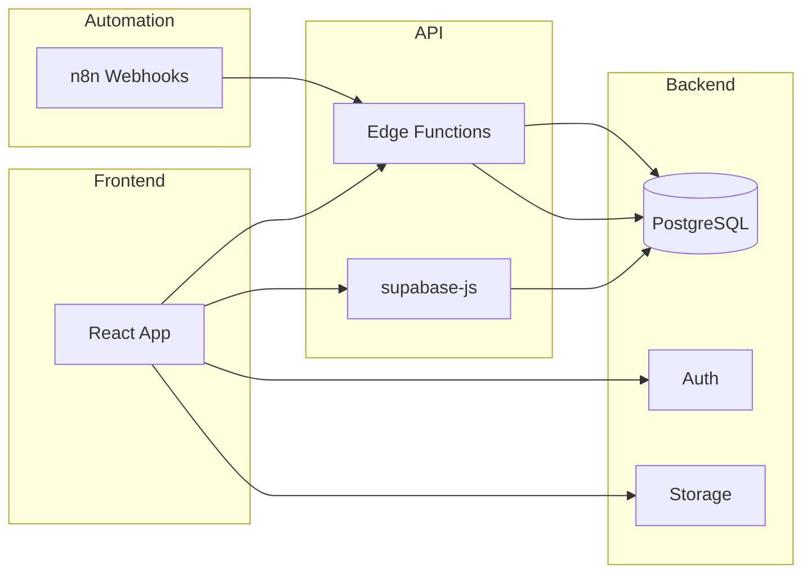

# LearnInk Architecture

## Analogi: LMS sebagai Restoran 🍽️

Untuk memahami arsitektur LearnInk, bayangkan sebuah **restoran**:

```
┌─────────────────────────────────────────────────────────────────┐
│                        LEARNINK RESTAURANT                       │
├─────────────────────────────────────────────────────────────────┤
│                                                                  │
│  🧑 PELANGGAN (Frontend)              🍳 DAPUR (Backend)         │
│  ├── Melihat menu                     ├── Menyimpan bahan       │
│  ├── Memesan makanan                  ├── Memasak pesanan       │
│  └── Menikmati hidangan               └── Menyajikan makanan    │
│                                                                  │
│              ▼                                   ▲               │
│              │                                   │               │
│              └──────► 🧑‍🍳 PELAYAN (API) ◄───────┘               │
│                       ├── Mencatat pesanan                       │
│                       ├── Membawa ke dapur                       │
│                       └── Menyajikan ke meja                     │
│                                                                  │
│  🤖 ROBOT OTOMATIS (n8n)                                         │
│  └── Mengantar bahan baku dari supplier (External Content)      │
│                                                                  │
└─────────────────────────────────────────────────────────────────┘
```

---

## Arsitektur Teknis

### 1. Frontend Layer (Pelanggan)
```
React + Vite + TypeScript
       │
       ├── Pages (Landing, Dashboard, ModuleLearn)
       ├── Components (UI primitives, Layout)
       ├── Contexts (Auth, Theme)
       └── Hooks (useUsers, useModules, dll)
```

**Tanggung Jawab:**
- Rendering UI yang responsif
- Mengelola state lokal
- Memanggil API/Backend untuk data

**Keunikan:** Client-Side Rendering (SPA) untuk interaktivitas tinggi.

---

### 2. API Layer (Pelayan)

LearnInk menggunakan **pendekatan Hybrid**:

#### A. Direct Supabase Client (Fast Path)
```
Frontend ──(supabase-js)───► Supabase PostgreSQL
```
Digunakan untuk operasi standar:
- Fetch modules, profiles, learning sources
- Auth operations (login, logout)
- Simple CRUD

#### B. Edge Functions (Smart Waiter)
```
Frontend ──(fetch)───► Edge Function ──► Supabase/External API
```
Digunakan untuk logic kompleks:
- `ingest-content`: Menerima konten dari n8n
- `generate-quiz`: Generate quiz dengan AI
- `generate-module`: Generate modul dengan AI
- `summarize-request`: Summarize request materi

**Keamanan:**
- Edge Functions menggunakan `service_role` key (tidak ter-expose ke client)
- Validasi input dengan strict typing
- Rate limiting per IP/API Key

---

### 3. Backend Layer (Dapur)

```
                    Supabase
                       │
       ┌───────────────┼───────────────┐
       │               │               │
   PostgreSQL      Storage         Auth
   ├── profiles    ├── avatars    ├── users
   ├── modules     └── files      ├── sessions
   ├── lessons                    └── JWTs
   ├── user_roles
   ├── learning_sources
   ├── incoming_contents
   ├── integrations
   └── security_logs
```

**Row Level Security (RLS):**
Setiap tabel memiliki RLS policies yang membatasi akses berdasarkan:
- `auth.uid()` - User yang sedang login
- `user_roles.role` - Role pengguna (admin, tutor, user)

---

### 4. Automation Layer (Robot Supplier) - n8n

```
External Source (YouTube, Blog, API)
       │
       ▼
    n8n Workflow
       │
       ├── Process/Transform Data
       │
       ▼
┌─────────────────────────────────┐
│ POST /ingest-content            │
│ Authorization: Bearer sk_live_* │
│ Body: { title, content, tags }  │
└─────────────────────────────────┘
       │
       ▼
   Edge Function
       │
       ├── Validate API Key (bcrypt hash check)
       ├── Rate Limit Check
       ├── Insert to `incoming_contents` (status: pending)
       │
       ▼
   Admin Review (Dashboard > Inbox Review)
       │
       └── Approve/Reject → Insert to `modules`
```

---

## Data Flow Diagram



---

## Security Architecture

```
┌────────────────────────────────────────────────────┐
│                  DEFENSE IN DEPTH                   │
├────────────────────────────────────────────────────┤
│ Layer 1: Frontend                                   │
│ └── Input validation, sanitasi (DOMPurify)         │
├────────────────────────────────────────────────────┤
│ Layer 2: API/Edge Function                          │
│ └── Rate limiting, API key validation, logging     │
├────────────────────────────────────────────────────┤
│ Layer 3: Database                                   │
│ └── Row Level Security, Triggers, Constraints      │
├────────────────────────────────────────────────────┤
│ Layer 4: Supabase Platform                          │
│ └── SSL/TLS, Leaked Password Protection            │
└────────────────────────────────────────────────────┘
```
