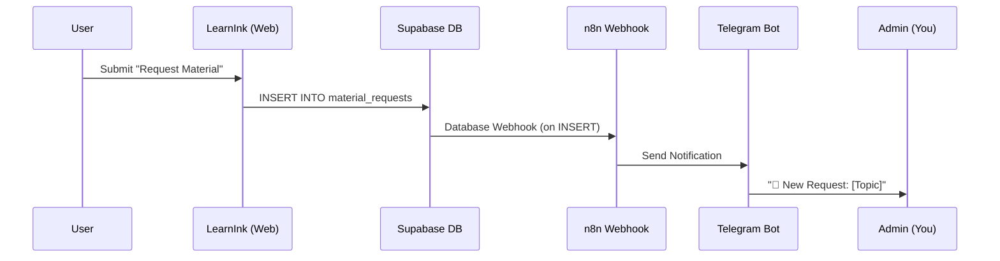

# AUTOMATION FLOW: Request -> n8n -> Telegram

> **Status**: Draft Proposal
> **Goal**: Menghubungkan sistem request materi di LearnInk dengan notifikasi Telegram via n8n.

## 1. Alur Sistem (System Flow)



## 2. Komponen yang Dibutuhkan

### A. Supabase Database Webhook
*   **Trigger**: `INSERT` on `material_requests` table.
*   **Target**: n8n Webhook URL.
*   **Payload**: Data request (topic, description, user_id, created_at).

### B. n8n Workflow
1.  **Trigger Node**: Webhook (Receive data from Supabase).
2.  **Logic Node** (Optional): Format pesan, enrichment (lookup user email).
3.  **Telegram Node**: Send message ke chat ID Anda.

### C. Telegram Bot
*   Buat bot via @BotFather.
*   Dapatkan `BOT_TOKEN` dan `CHAT_ID` Anda.

## 3. Format Pesan Telegram

```
📩 *Material Request Baru*

*Topic:* {{ $json.topic }}
*Description:* {{ $json.description }}
*User:* {{ $json.user_id }}
*Time:* {{ $json.created_at }}

➡️ [Lihat di Dashboard](https://your-domain.com/dashboard/admin?tab=requests)
```

## 4. Opsi Implementasi

### Opsi A: Supabase Database Webhook (Recommended)
*   **Pro**: Native, tidak perlu polling, real-time.
*   **Con**: Memerlukan setup di Supabase Dashboard.
*   **Setup**:
    1.  Buka Supabase Dashboard > Database > Webhooks.
    2.  Create Webhook:
        *   Table: `material_requests`
        *   Event: `INSERT`
        *   URL: `[n8n_webhook_url]`
        *   Headers: `Authorization: Bearer [secret_key]` (untuk keamanan).

### Opsi B: Supabase Edge Function
*   **Pro**: Lebih fleksibel, bisa add logic.
*   **Con**: Perlu deploy function terpisah.
*   **Use Case**: Jika butuh pre-processing data sebelum kirim ke n8n.

### Opsi C: n8n Polling (Fallback)
*   **Pro**: Tidak perlu setup webhook di Supabase.
*   **Con**: Delay (tidak real-time), boros API call.
*   **Setup**: n8n Schedule Trigger -> Query Supabase for new `pending` requests.

## 5. Update Flag `n8n_processed`

Setelah n8n sukses kirim notifikasi, update database:

```sql
UPDATE material_requests
SET n8n_processed = true, n8n_processed_at = NOW()
WHERE id = '{{ $json.id }}';
```

Node di n8n: **Supabase Node** (Update operation).

## 6. Action Items

1.  [ ] Buat Telegram Bot & dapatkan credentials.
2.  [ ] Setup n8n Workflow (Webhook -> Telegram).
3.  [ ] Konfigurasi Supabase Database Webhook.
4.  [ ] Test end-to-end.

## Diskusi

Apakah Anda sudah memiliki Telegram Bot yang bisa dipakai, atau perlu dibuat baru?
